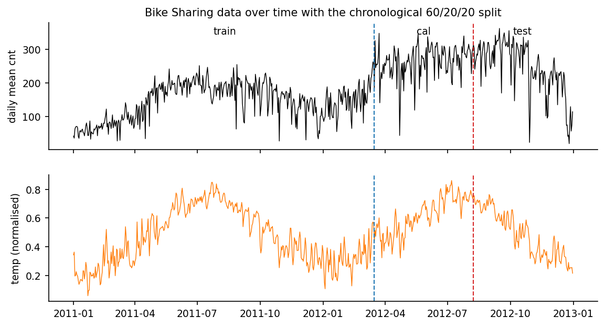
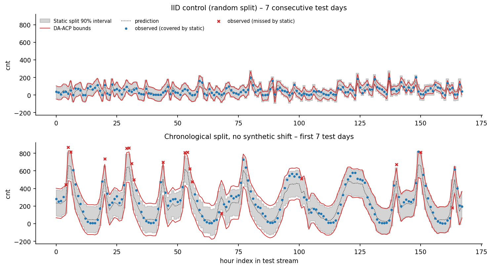
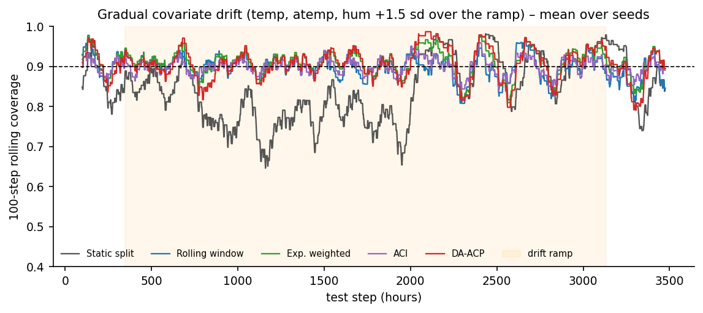
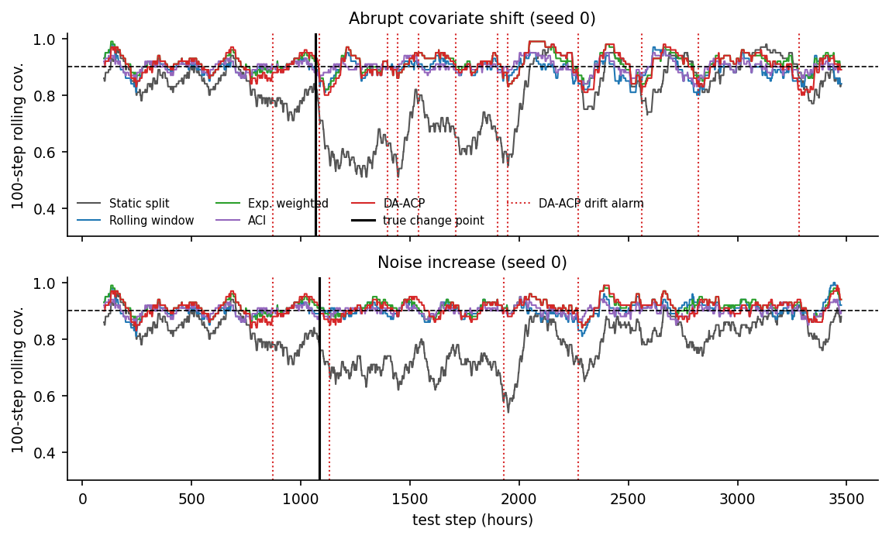
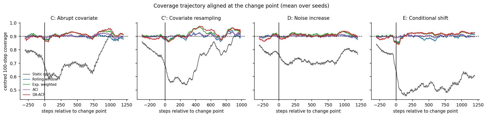
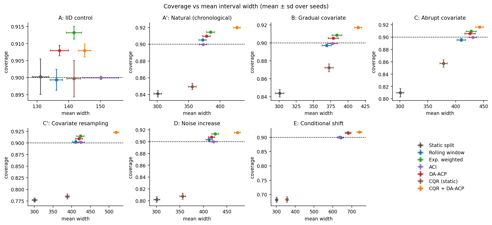
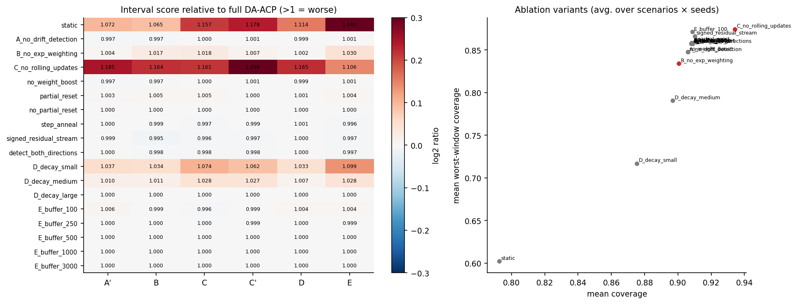
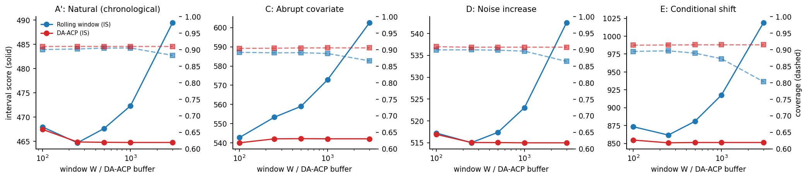
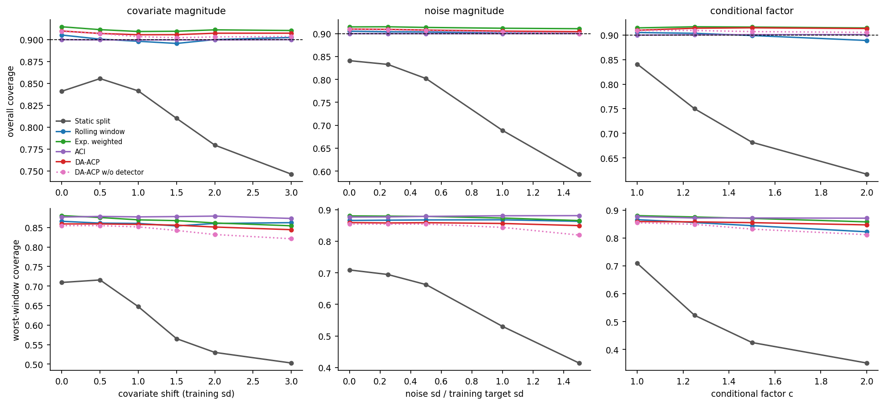
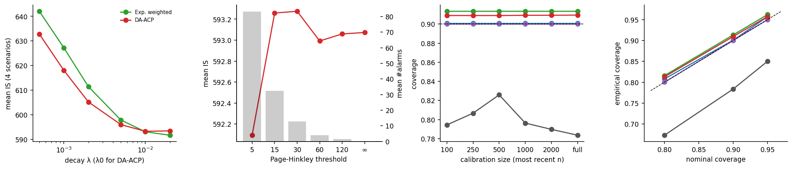

# Adaptive Conformal Prediction under Distribution Shift
## An Empirical Study of Drift-Aware Calibration and Uncertainty Quantification for Regression

*Reproducible research report. Every number here is read from `results/tables/`, which `experiments/analyze.py` generates from the raw outputs in `results/raw/`.*

---

## Abstract

Point predictions come with no measure of uncertainty. Split conformal prediction turns any regressor into prediction intervals with a finite-sample marginal coverage guarantee, but only if calibration and test data are exchangeable. We study empirically what happens when that assumption fails, using the UCI Bike Sharing hourly data in chronological order. We add seven controlled scenarios: an exchangeable control, the natural temporal drift, gradual and abrupt covariate drift, pure covariate resampling, increased noise, and a subgroup-specific conditional shift.

We compare five calibrators: static split conformal, a rolling window, exponentially weighted conformal, adaptive conformal inference (ACI), and a drift-aware combination we call DA-ACP. DA-ACP pairs exponential recency weights with a Page-Hinkley detector that temporarily increases the decay after an alarm. CQR serves as a benchmark. Hyperparameters were chosen on a development split nested inside the training period and then frozen.

Static conformal prediction covers 0.900 under exchangeability. Under real temporal drift alone it covers only 0.841, and under synthetic shifts it falls to 0.68–0.81, with worst 250-hour windows as low as 0.43. Every adaptive calibrator restores roughly 0.90 marginal coverage in every scenario. The intervals are 23–43% wider (111–126% under the conditional shift), and interval scores improve by 5–33% over static.

**DA-ACP is not better than a well-tuned exponentially weighted conformal predictor.** At the tuned decay, removing the drift detector changes the interval score by less than 0.3%. The detector helps substantially only when the baseline memory is long, and even then it does not match simply using a shorter memory. The effective memory length is the dominant design choice. Marginal recovery also hides failures within subgroups.

---

## 1. Introduction

A regression model outputs ŷ = f̂(x). For decisions such as fleet allocation or capacity planning we also need to know how far y might be from ŷ. Prediction intervals C(x) = [L(x), U(x)] should contain the true y with a stated probability (coverage). They should also be as narrow as possible (efficiency, or sharpness).

Conformal prediction [1, 2] offers distribution-free intervals: given any fitted model and a held-out calibration set, the interval contains a new y with probability at least 1 − α. The guarantee rests on **exchangeability**, meaning the calibration and test points are statistically interchangeable. Deployed systems violate this all the time. Sensors drift, seasons change, user behaviour evolves, noise levels vary. A conformal predictor calibrated on the past can then under-cover, over-cover, or adapt too slowly.

**Contribution.** We do not propose a new conformal algorithm with new guarantees. We build and evaluate a transparent drift-aware adaptive calibration framework (DA-ACP) that combines known ingredients: rolling calibration, exponential recency weighting [5] and Page-Hinkley detection [7]. We compare it rigorously against simpler adaptive baselines and ACI [4] under controlled shifts, run ablations of each component, and report negative results as they occurred.

## 2. Research questions and hypothesis

- **RQ1:** Does split conformal keep nominal coverage when the data are exchangeable?
- **RQ2:** How does coverage change under distribution shift?
- **RQ3:** Can rolling-window recalibration recover coverage?
- **RQ4:** Does exponential weighting improve on an unweighted rolling window?
- **RQ5:** Does explicit drift detection improve the coverage/efficiency trade-off?
- **RQ6:** How much width does nominal coverage cost?
- **RQ7:** How robust are the methods across shift types, magnitudes and calibration-set sizes?
- **RQ8:** When do adaptive methods fail?

**Hypothesis (empirical, not a theorem).** When the test distribution differs from the calibration distribution, a drift-aware adaptive conformal strategy recovers empirical coverage better than static split conformal without making the intervals excessively wide.

## 3. Background

**Split conformal regression.** Fit f̂ on training data. Compute calibration scores s_i = |y_i − f̂(x_i)|, i = 1..n. Let q̂ be the ⌈(n+1)(1−α)⌉-th smallest s_i. The interval is C(x) = [f̂(x) − q̂, f̂(x) + q̂]. If (x_i, y_i), i = 1..n+1, are exchangeable, then P(Y_{n+1} ∈ C(X_{n+1})) ≥ 1 − α. If the scores are almost surely distinct, the probability is also ≤ 1 − α + 1/(n+1) [1, 2]. The guarantee is **marginal**: it averages over test points and says nothing about coverage for a particular x or subgroup.

**Exchangeability and distribution shift.** Exchangeability means the joint distribution is invariant to permutations. The relevant kinds of shift are:

- covariate shift: P(X) changes, P(Y|X) does not;
- label or conditional shift: P(Y|X) changes;
- noise (heteroscedasticity) changes;
- temporal dependence, which breaks exchangeability even without shift.

**Weighted conformal prediction.** Weighted variants re-weight the calibration scores. Tibshirani et al. [5] show that likelihood-ratio weights restore validity under *known* covariate shift. Barber et al. [6] show that fixed, data-independent weights give a coverage gap bounded by a weighted total-variation distance between the data and their swaps. Placing large weights on recent points is a heuristic for making that term small when the recent past resembles the present. It is not a guarantee.

**ACI.** Gibbs & Candès [4] update the working miscoverage level online: α_{t+1} = α_t + γ(α − err_t). For *any* sequence, the ideal recursion has a long-run average miscoverage result at α. This is a time-average statement, not per-step or conditional coverage. Because the implementation caps +∞ thresholds at the largest observed score, its ACI results are a finite-width empirical reference rather than a literal application of that theorem.

**Drift detection.** Page-Hinkley [7] monitors a cumulative sum of deviations from the running mean and raises an alarm when the sum rises more than a threshold h above its historical minimum.

**Evaluation.** The interval score [8], IS = (U − L) + (2/α)(L − y)⁺ + (2/α)(y − U)⁺, is a proper scoring rule for central (1 − α) intervals. It combines width and a penalty for misses, so it avoids the "higher coverage is always better" trap.

## 4. Methodology

### 4.1 Base predictors

We use four scikit-learn pipelines: Ridge (α = 1), Random Forest (200 trees), Gradient Boosting (GBR: 300 trees, learning rate 0.05, depth 5, subsample 0.8) and HistGradientBoosting. The primary model is GBR. Preprocessing sits inside each pipeline and is fitted on the training split only:

- median imputation and standardisation of the numeric weather features;
- one-hot encoding of weathersit, season, weekday and hour;
- stateless sin/cos encodings of hour, month and weekday.

`casual` and `registered` sum to the target and are rejected by a leakage check. Hyperparameters are fixed a priori; the conformal layer is the object of study. CQR uses two HistGB quantile regressors at α/2 and 1 − α/2.

### 4.2 Nonconformity scores and the online protocol

Every calibrator maps the history of past scores to a threshold q_t. The interval is [f̂(x_t) − q_t, f̂(x_t) + q_t]; for CQR it is [q̂_lo(x_t) − q_t, q̂_hi(x_t) + q_t] with score max(q̂_lo − y, y − q̂_hi) [3]. Coverage and ACI feedback are evaluated from the defining event s_t ≤ q_t. This matters for the rare negative-CQR-threshold case, where the exact score-defined set can be empty even though display bounds are kept ordered for plotting. The test stream is processed causally (`run_online`):

1. Compute q_t from scores observed before t.
2. Report the interval.
3. Observe y_t.
4. Compute s_t and update the calibrator and detector.

A unit test checks that perturbing future scores never changes past thresholds. The adaptive methods use test labels only **after** each prediction, as a deployed online system would. The base model is never retrained.

### 4.3 Quantile conventions (`src/conformal/quantiles.py`)

- **Unweighted:** q = s_(k) with k = ⌈(n+1)(1−α)⌉, and q = +∞ if k > n. No interpolation.
- **Weighted:** with weights w_i ≥ 0 on stored scores and test weight w_{n+1} = 1 placed at +∞, q = inf{s : Σ_{i: s_i ≤ s} w_i / (Σ_j w_j + w_{n+1}) ≥ 1 − α}. With equal weights this equals the unweighted rule exactly (unit-tested). Weights change the *probability mass* of scores; the scores themselves are never multiplied by weights.
- **Infinite thresholds:** +∞ is replaced by the largest score seen and counted (`n_infinite`). Only ACI produces them: in 2–6% of test steps, when α_t ≤ 0.

### 4.4 Calibrators

| Method | q_t |
|---|---|
| Static split | Conformal quantile of the n = 3476 calibration scores, fixed |
| Rolling | Conformal quantile of the last W scores (calibration scores, then observed test scores) |
| Exp. weighted | Weighted quantile, w = exp(−λ·age), buffer ≤ 3000; the newest score has age 1, the test point age 0 |
| ACI | Conformal quantile at level α_t of the last 1000 scores; α_{t+1} = α_t + γ(α − err_t) |
| **DA-ACP** | Weighted quantile with a time-varying decay λ_t and optional pre-onset down-weighting |

**DA-ACP.** Let τ be the time of the latest Page-Hinkley alarm and t₀ its estimated onset (the argmin of the cumulative sum).

- Decay after an alarm: λ_t = λ₀ + (λ_fast − λ₀)·max(0, 1 − (t − τ)/B). Before any alarm, λ_t = λ₀.
- Weights: w_i = exp(−λ_t·age_i)·g_i, where g_i = ρ if score i predates t₀ and is not among the 50 newest scores, and g_i = 1 otherwise.
- Detector input: z_t = s_t / mean(s_cal). One-sided test for an increase, δ = 0.1, threshold h.
- Ablation switches:
  - drift detection off (A);
  - box kernel of length 2/λ_t, matched in effective sample size (B);
  - frozen buffer that is replaced by post-onset scores only after an alarm (C);
  - no λ boost;
  - partial reset ρ = 0.1;
  - step instead of linear annealing;
  - signed-residual or two-sided detector.

**Frozen hyperparameters** (from development tuning, §5.4):

| Method | Setting |
|---|---|
| Rolling | W = 50 |
| Weighted | λ = 0.02 |
| ACI | γ = 0.05 |
| DA-ACP | λ₀ = 0.01, λ_fast = 0.02, h = 30, ρ = 1 (no partial reset), B = 200, buffer 3000 |

**No guarantee.** Under temporal dependence and shift, none of these methods carries a finite-sample coverage guarantee. The ideal ACI recursion has a long-run average statement for arbitrary sequences, but this implementation replaces its infinite thresholds with the largest observed score so that widths remain finite; the reported ACI results are therefore an empirical, capped reference. The evaluation is otherwise purely empirical.

## 5. Experimental setup

### 5.1 Data

UCI Bike Sharing, hourly [9]: 17,379 rows from 2011-01-01 to 2012-12-31 (165 hours missing). The target is `cnt`. The chronological 60/20/20 split is shown in the table and in Figure 0.

| Split | n | Period | Mean cnt | SD cnt |
|---|---|---|---|---|
| Train | 10,427 | 2011-01-01 → 2012-03-15 | 144.8 | 134.6 |
| Calibration | 3,476 | 2012-03-15 → 2012-08-07 | 264.2 | 215.5 |
| Test | 3,476 | 2012-08-07 → 2012-12-31 | 248.8 | 220.5 |

The data are not stationary even before any synthetic shift. The calibration period (spring/summer 2012) and the test period (autumn/winter 2012) differ in season and in the model's error level.



### 5.2 Shift scenarios

Synthetic shifts are applied only to a copy of the test stream. The change point is at 30% of the stream ± 5% jitter per seed (≈ step 900–1200). Magnitudes are measured in training-split standard deviations.

| ID | Scenario | Transformation |
|---|---|---|
| A | IID control | Random split membership (exchangeable) |
| A' | Natural | Chronological split, no synthetic shift |
| B | Gradual covariate | temp, atemp, hum + 1.5·sd·ramp; ramp from 10% to 90% of the stream |
| C | Abrupt covariate | temp, atemp, hum + 1.5·sd after the change point |
| C' | Covariate resampling | After the change point, keep off-peak hours with p = 0.15 (P(Y\|X) unchanged) |
| D | Noise | y + N(0, (0.5·sd_train(y))²) after the change point |
| E | Conditional | y × 1.5 on working days after the change point |

The covariate shifts B and C leave y unchanged. The *observed* features therefore drift away from the ones that generated y, a model of sensor drift. This changes the relationship between the observed X and Y, so B and C are not pure covariate shifts; C' is.

### 5.3 Metrics

- Coverage and coverage gap |cov − 0.9|.
- Mean width.
- Mean interval score.
- Worst-window coverage: the minimum 250-step rolling coverage.
- Post-shift coverage over the first 500 steps after the change.
- Recovery time: steps until the 100-step post-change rolling coverage stays within ±0.05 of 0.9 for 50 steps. The floor is 99 steps, because a full window is needed.
- Detection delay and false alarms before the change.
- MAE and RMSE of the point model.
- Subgroup coverage: working vs non-working days; affected vs unaffected rows.

### 5.4 Protocol, tuning and seeds

**Tuning.** All hyperparameters were selected by `run_tuning.py` on a **development protocol**: a chronological 60/20/20 train/cal/test split *nested inside the outer training period*, with the same six non-IID scenarios and three dev seeds (100–102). Each method family got a grid. The criterion was the mean interval score relative to static, which is proper and normalises across scenarios.

The first grid (v1, kept in `results/tuning/tuning_results_grid_v1.csv`) placed the optima for rolling, weighted and DA-ACP on the grid boundary. The grids were therefore extended once (v2) **on the development split only**. The outer test split was not used for any choice. Test-protocol sensitivity analyses are descriptive only.

**Seeds.** Test-protocol experiments use 10 seeds (0–9). A seed controls the change-point jitter, the noise and subsampling draws, and model randomness. All seeds share the same test period, so the spread across seeds understates real-world uncertainty.

**Statistics.** The unit of analysis is the seed, paired across methods. We report paired bootstrap CIs and Wilcoxon signed-rank p-values as descriptive evidence, with no multiplicity correction.

**Reproducibility.** Re-running seeds 0–1 from scratch reproduces all metrics bit-for-bit (maximum absolute difference 0.0).

## 6. Results

### 6.1 Point models (Table 2)

| Model | Test MAE (full features) | Test R² (full) | Test MAE (no yr/season/mnth) |
|---|---|---|---|
| Ridge | 105.1 | 0.569 | 121.5 |
| Random forest | 87.2 | 0.697 | 98.0 |
| **GBR** | **76.0** | **0.772** | 99.3 |
| HistGB | 78.5 | 0.752 | 98.6 |

Under the IID split, GBR reaches MAE 28.0 (R² 0.94). The chronological split almost triples the error: this is the real temporal shift. Removing the time-identifying variables hurts every model (§6.7).

### 6.2 RQ1: exchangeable control (Table 3a)

| Method | Coverage | Width | Interval score | Worst window |
|---|---|---|---|---|
| Static split | **0.900 ± 0.005** | 131.1 | 209.2 | 0.792 |
| Rolling (W = 50) | 0.899 ± 0.003 | 136.1 | 206.9 | 0.866 |
| Exp. weighted | 0.913 ± 0.002 | 141.6 | 204.8 | 0.876 |
| ACI | 0.900 ± 0.001 | 150.2 | 218.8 | 0.874 |
| DA-ACP | 0.908 ± 0.002 | 137.1 | 204.4 | 0.860 |
| CQR (static) | 0.900 ± 0.005 | 141.6 | **179.6** | 0.847 |

Static split conformal reaches exactly nominal coverage, as theory predicts. The adaptive methods are also near nominal. Exponential weighting over-covers slightly (0.913): with λ = 0.02 its effective sample size is only about 100, and the finite-sample correction (n+1) then matters. CQR has the best interval score, because bike counts are strongly heteroscedastic and CQR's input-dependent intervals exploit that.



*Figure 1. GBR prediction intervals, first test week. Top: IID control. Bottom: chronological split. There, static misses the evening peaks (red crosses); DA-ACP's bounds are wider because recent residuals are larger.*

### 6.3 RQ2: distribution shift degrades static conformal (Tables 3b–6b)

Coverage / mean interval score for each scenario (10 seeds):

| Scenario | Static | Rolling | Exp. weighted | ACI | DA-ACP | CQR static | CQR + DA-ACP |
|---|---|---|---|---|---|---|---|
| A: IID control | 0.900 / 209 | 0.899 / 207 | 0.913 / 205 | 0.900 / 219 | 0.908 / 204 | 0.900 / 180 | 0.908 / 180 |
| A': Natural | 0.841 / 498 | 0.905 / 465 | 0.915 / 465 | 0.900 / 471 | 0.910 / 465 | 0.849 / 554 | 0.920 / 513 |
| B: Gradual cov. | 0.844 / 510 | 0.897 / 477 | 0.909 / 477 | 0.900 / 478 | 0.905 / 480 | 0.872 / 560 | 0.917 / 506 |
| C: Abrupt cov. | 0.810 / 627 | 0.896 / 537 | 0.909 / 538 | 0.900 / 545 | 0.906 / 542 | 0.857 / 610 | 0.916 / 537 |
| C': Resampling | 0.777 / 583 | 0.902 / 498 | 0.914 / 493 | 0.902 / 508 | 0.909 / 495 | 0.785 / 685 | 0.923 / 599 |
| D: Noise | 0.802 / 574 | 0.904 / 516 | 0.913 / 516 | 0.900 / 529 | 0.908 / 515 | 0.808 / 626 | 0.915 / 569 |
| E: Conditional | **0.682** / 1231 | 0.899 / 853 | 0.916 / 847 | 0.901 / 830 | 0.915 / 851 | 0.683 / 1291 | 0.919 / 921 |

- **The real data alone break static conformal.** With a chronological split and no synthetic shift, static covers 0.841 and its worst 250-hour window is 0.709. Static CQR is no better (0.849). The calibration period is not exchangeable with the test period.
- **The conditional shift causes the largest degradation.** Static coverage falls to 0.682, the worst window to 0.425, and post-shift coverage to 0.503. Static never recovers in 6 of 10 seeds.
- The next most damaging shifts are covariate resampling (0.777; worst window 0.540), noise (0.802) and the abrupt covariate shift (0.810; worst window 0.565).

### 6.4 RQ3–RQ5: adaptation, weighting and detection

Every adaptive calibrator restores marginal coverage to 0.896–0.916 in every scenario. The differences among them are small compared with their gap to static:

- **Rolling vs weighted (RQ4).** Interval scores are within 1% of each other in every scenario. Exponential weighting is slightly more conservative: coverage is 0.01 higher, width is 3–6% larger, and the worst window is better (0.868–0.880 vs 0.844–0.869). Both were tuned to short memories (W = 50; λ = 0.02, effective n ≈ 100).
- **ACI** hits 0.900 almost exactly in every scenario in these finite experiments, and it has the best worst-window coverage (≈ 0.87–0.88). However, it needs +∞ thresholds in 2–6% of steps; this implementation caps them at the largest score seen, so the ideal long-run theorem does not apply literally. It has the *worst* interval score among adaptive methods in five of seven scenarios. The conditional shift is the exception, where ACI is best (830).
- **DA-ACP vs baselines (paired, Table "stats_paired").** DA-ACP beats static in every scenario and seed, by 4.8 (IID control) to 380 (conditional) interval-score points. Against the adaptive baselines the differences are a few points on scores of 200–850 (≤ 1%), with mixed signs. DA-ACP is significantly *worse* than weighted in B, C, C' and E (by 2.4–4.1 points, 0/10 seeds better) and slightly better under noise (−1.2 points, 10/10 seeds). These differences are statistically detectable but practically negligible.



*Figure 2. Gradual drift: static degrades steadily as the ramp progresses; the adaptive methods stay near 0.90.*



*Figure 3. Abrupt covariate shift (top) and noise increase (bottom), seed 0, with the true change point and DA-ACP alarms. Several alarms occur before the change point; they respond to real drift in the error stream (compare A').*



*Figure 6. Centred 100-step coverage aligned at the change point, averaged over seeds. The adaptive methods dip to about 0.86 for roughly 100 steps and then recover; static drops to 0.45–0.65.*

**Recovery speed (Question C).** The adaptive methods recover within about 100–140 steps (the floor is 99), against 760–2350 steps for static:

| Scenario | Static | Rolling | Weighted | ACI | DA-ACP |
|---|---|---|---|---|---|
| Abrupt covariate | 944 | 119 | 127 | 99 | 137 |
| Resampling | 762 | 124 | 125 | 99 | 139 |
| Noise | 1488 | 100 | 108 | 99 | 114 |
| Conditional | 2351 (4/10 recovered) | 136 | 132 | 99 | 134 |

ACI always recovers at the floor. DA-ACP is not faster than the plain weighted method.

**Drift detection (Figure 12).** The Page-Hinkley detector on absolute residuals raises its first post-change alarm after:

| Scenario | Mean delay (steps) | Notes |
|---|---|---|
| Abrupt covariate | 22 | |
| Conditional | 24 | |
| Resampling | 46 | |
| Noise | 70 | 1 of 10 seeds missed |
| Gradual (from ramp start) | 487 | |

It also fires 4.3 times on the exchangeable control and 5.8 times on the natural stream. On the control these are false alarms. On the natural stream they partly reflect real changes in the error distribution. At h = 30 the detector is therefore sensitive rather than specific.

### 6.5 RQ6: the price of coverage (Question D)



*Figure 5. Coverage vs mean width. In every shift scenario the adaptive methods form a tight cluster at ≈ 0.90 coverage. Static sits far below at a smaller width.*

Compared with static, the adaptive methods widen intervals by:

| Scenario | Width increase |
|---|---|
| IID | 4–15% |
| Natural and gradual | 23–28% |
| Abrupt, resampling, noise | 36–43% |
| Conditional | 111–126% |

Interval scores nonetheless *improve* by 5.5–6.7% (natural, gradual), 7.7–15.5% (abrupt, resampling, noise) and 31–33% (conditional). The extra width is not waste: static is too narrow for the post-shift regime and pays heavily in miss penalties. Only in the IID control is the extra width nearly unnecessary (interval score within ±5% of static). There, ACI's larger width gives a 4.6% *worse* interval score.

### 6.6 CQR

Static CQR is the best method under exchangeability (interval score 180 vs 209) but degrades just like static split conformal under shift (0.68–0.87 coverage). Combined with the DA-ACP calibrator, its coverage recovers (0.915–0.923) but it over-covers and becomes wider. Its interval score is better than DA-ACP with absolute residuals only in the IID control (180 vs 204) and the abrupt covariate case (537 vs 542). In the other scenarios it is worse (e.g. resampling 599 vs 495).

The likely reason: the CQR quantile models learn the training-period heteroscedasticity. After the shift, a *single additive* correction q_t cannot fix a mis-shaped band, whereas the symmetric score adapts in one dimension only. In the natural stream the detector fires twice as often on CQR scores as on absolute residuals (11.6 vs 5.8 alarms).

### 6.7 Generalisation across base models (Question G, Table 9) and time-identifying features (Table 10)

The qualitative picture is the same for Ridge, RF, GBR and HistGB:

- Static breaks under chronological splits and shifts.
- All adaptive methods restore about 0.90–0.92.
- Rolling, weighted and DA-ACP are within about 1% in interval score, and ACI is sometimes better and sometimes worse.

Worse point models degrade *less* under shift in relative terms: static Ridge covers 0.894 on the natural stream vs 0.841 for GBR. A plausible explanation is that their residuals are already large and dominated by stable structure, so drift shows up less.

Removing `yr`, `season` and `mnth` raises GBR's test MAE from 76 to 99. It does not change the conformal conclusions: static covers 0.857 on the natural stream and DA-ACP 0.913. The time-identifying features are therefore not an "artificial shortcut" that explains the results. `yr` in fact *helps*, because it captures the 2012 growth in demand.

## 7. Ablation study (Question E)



*Figure 9. Interval score of each variant relative to full DA-ACP, per scenario (left), and coverage vs worst-window coverage (right).*

Averages over 6 scenarios × 10 seeds, relative to full DA-ACP (< 1 means the variant is better):

| Variant | Coverage | Worst window | Rel. IS | Better than full |
|---|---|---|---|---|
| Full DA-ACP | 0.909 | 0.857 | 1.000 | – |
| A: no drift detection | 0.906 | 0.848 | 0.999 | 40/60 |
| B: box kernel (no exp. weighting) | 0.901 | 0.834 | 1.013 | 1/60 |
| C: no rolling updates (frozen, refreshed on alarm) | 0.934 | 0.874 | **1.180** | 0/60 |
| No λ boost | 0.906 | 0.848 | 0.999 | 40/60 |
| Partial reset ρ = 0.1 | 0.911 | 0.859 | 1.003 | 7/60 |
| Signed-residual two-sided detector | 0.910 | 0.866 | 0.997 | 54/60 |
| D: λ₀ small (0.0005) | 0.875 | 0.717 | 1.057 | 0/60 |
| D: λ₀ medium (0.002) | 0.897 | 0.790 | 1.019 | 0/60 |
| E: buffer 100 … 3000 | 0.908–0.909 | 0.857–0.871 | 1.000–1.001 | – |

Findings:

1. **Continuous updating matters most (C).** A calibration set that is frozen and refreshed only after alarms is 18% worse and over-covers (0.934). Updating only when the detector fires is much worse than always updating.
2. **Memory length is the next most important factor (D).** Longer memories (small λ₀) under-cover after shifts: worst window 0.72, post-shift coverage 0.77.
3. **Exponential vs box weights (B)** at matched effective size: the exponential kernel is slightly better (1.3%) and has better worst-window coverage.
4. **The drift detector itself (A) contributes nothing measurable at the tuned λ₀.** The variant without it is better in 40 of 60 runs, with an interval score within 0.1%. Worst-window coverage drops slightly without it (0.848 vs 0.857). With λ₀ = 0.01 and λ_fast = 0.02 the boost barely changes the weights. Tuning chose this regime because a fast base memory already tracks the shifts.
5. The partial reset, annealing schedule and buffer length hardly matter (±0.3%). The signed/two-sided detector is marginally better (0.997), with 2.6× more alarms.

**Follow-up: when does detection help? (Table 7b, `ablation_slow_base`).** Finding 4 prompted a second question after seeing the main ablation. Does the detector add value when the baseline memory is slow? We compared DA-ACP (λ₀ = λ, λ_fast = 0.02) with weighted conformal at the same λ, paired over 60 runs. This follow-up was run after the main results and should be read as exploratory.

| λ₀ | Detector: rel. IS vs weighted(λ) | Worst window (weighted → DA-ACP) | Post-shift coverage (weighted → DA-ACP) | Runs better |
|---|---|---|---|---|
| 0.0005 | 0.965 | 0.703 → 0.800 | 0.756 → 0.868 | 60/60 |
| 0.0005 + partial reset | 0.958 | 0.703 → 0.820 | 0.756 → 0.894 | 60/60 |
| 0.001 | 0.976 | 0.728 → 0.814 | 0.783 → 0.876 | 57/60 |
| 0.002 | 0.988 | 0.765 → 0.829 | 0.824 → 0.886 | 50/60 |

With slow memory the detector clearly helps: post-shift coverage rises by 6–14 points, and the partial reset adds a little more. Even so, the best slow DA-ACP variant (λ₀ = 0.002) has a 1.3% *worse* interval score than the tuned fast weighted method.

**Answer to RQ5.** In this study, drift detection helps a method whose memory is too long, but choosing a short memory in the first place helps more. A detector would be worth its complexity when there is a strong reason to keep a long memory, for example very noisy scores or a high nominal level that needs many samples. This study did not examine that case.

## 8. Sensitivity analysis (Question F; descriptive, test protocol)





- **Nominal level.** At α = 0.2, 0.1 and 0.05 the adaptive methods reach 0.80–0.82, 0.90–0.91 and 0.95–0.96. ACI hits the target exactly but needs +∞ thresholds far more often at α = 0.05 (1636 steps per 4 scenarios). Static under-covers at every level (0.67, 0.78, 0.85).
- **Calibration size.** Static coverage does not improve with more calibration data; the best is 0.826 at n = 500. The most recent 500 points are closer to the test period, and adding older, larger-n data makes it worse. The adaptive methods are unaffected, because their initial buffer is quickly replaced.
- **Window / decay.** The rolling interval score worsens as W grows (599 at W = 250 → 663 at W = 3000, where coverage is 0.854). Weighted and DA-ACP improve monotonically from λ = 0.0005 (IS 642, coverage 0.871) to λ = 0.01–0.02 (IS 592–593). DA-ACP's buffer length has no effect, because exponential weights make old scores negligible.
- **Page-Hinkley threshold.**

  | h | Mean alarms | False alarms | Mean IS |
  |---|---|---|---|
  | 5 | 83 | 39 | 592.1 |
  | 30 | 12.9 | 2.3 | 593.3 |
  | ∞ (never fires) | 0 | 0 | 593.1 |

  The interval score is flat. Lower thresholds raise worst-window coverage slightly (0.874 at h = 5 vs 0.846 at h = ∞).
- **Shift magnitude.** Static coverage falls steadily as the shift grows:

  | Shift | Mildest → strongest | Static coverage |
  |---|---|---|
  | Covariate | 0 → 3 sd | 0.84 → 0.75 |
  | Noise | 0 → 1.5 sd | 0.84 → 0.59 |
  | Conditional | c = 1 → 2 | 0.84 → 0.62 |

  The adaptive methods stay at 0.89–0.92 overall. Their worst-window coverage erodes slowly (DA-ACP 0.86 → 0.84–0.85; without the detector 0.86 → 0.81–0.82; ACI stable at ≈ 0.87–0.88). The detector's small contribution grows with shift magnitude.

## 9. Failure analysis (Question H, RQ8)

1. **Subgroup under-coverage under conditional shift.** When y × 1.5 applies only to working days, every marginal method restores overall coverage (≈ 0.90–0.92) by widening *all* intervals. The affected rows stay under-covered (0.85–0.88) and the unaffected post-shift rows are over-covered (0.97–1.00). Marginal adaptation cannot fix subgroup-specific shifts. Subgroup-aware (Mondrian) calibration or model retraining would be needed.
2. **Transient under-coverage right after abrupt changes.** All adaptive methods dip to ≈ 0.85–0.87 local coverage for about 100 steps (Figure 6). No calibrator can react before it has seen post-change residuals. Only ACI's error feedback shortens this dip.
3. **Long memory means slow recovery.** Rolling with W = 3000 or weighted with λ = 0.0005 behave almost like static (coverage 0.85–0.87, worst window ≈ 0.70).
4. **False alarms.** The detector fires on stationary data (4.3 alarms per IID stream at h = 30; 39 at h = 5). In DA-ACP false alarms are cheap: they briefly shorten memory. With the partial reset they discard useful data.
5. **Degenerate thresholds.** ACI's α_t can drop below 0, which produces infinite intervals in up to 6% of steps (more at α = 0.05). We cap them; a real deployment would need to decide how to handle them.
6. **Over-coverage and extra width with CQR + adaptation.** Adaptive calibration of CQR scores over-covers (0.92) and can be much wider than adaptive absolute-residual intervals.
7. **Negative intervals.** Symmetric intervals on counts extend below 0 (Figure 1). Clipping at 0 would not reduce coverage, but we did not apply it, to keep the comparison clean.

## 10. Limitations

- **One dataset and one test period.** The 10 seeds vary the shift randomisation and model seeds but not the underlying data, so the spread understates real uncertainty. The p-values are descriptive.
- **Stylised synthetic shifts.** In particular, the covariate shifts that keep y fixed amount to "sensor drift". Real shifts can combine several mechanisms.
- **Tuning on the development period.** The development period (Jul 2011 – Mar 2012) has its own dynamics. The finding that fast memories win may partly reflect Bike Sharing's strong, fast-changing residual structure. The grid was extended once, on dev data only.
- **Frozen point model.** Adapting the model itself, for example with periodic retraining, might make calibration adaptation less important. We did not test this (see Future work).
- **Marginal coverage only.** Conditional coverage is only diagnosed, never targeted.
- **No new theory.** DA-ACP has no coverage guarantee under temporal dependence or shift. Neither does weighted conformal with recency weights. Ideal ACI has a long-run average result, but the capped ACI implementation evaluated here should not be presented as inheriting it exactly.
- **Detector choice.** Only Page-Hinkley was implemented, with a single scaling of its input. ADWIN or CUSUM variants could behave differently.

## 11. Conclusion

What the experiments establish on this dataset:

1. Split conformal prediction delivers exactly nominal coverage under exchangeability (0.900) and **fails under realistic temporal drift even without synthetic shifts** (0.841), and more severely under controlled shifts (0.68–0.81).
2. **Any causal, continuously updated calibrator with a short memory** (rolling window, exponential weights, ACI or DA-ACP) restores roughly 0.90 marginal coverage in every scenario. It needs about 100–140 steps to recover after an abrupt change and costs 23–43% more width (more under conditional shift), which pays off in 5–33% better interval scores.
3. **The primary hypothesis is only partly supported.** A drift-aware adaptive strategy does recover coverage far better than static conformal without excessive width. But the *drift-aware* component adds essentially nothing over a well-tuned recency-weighted conformal predictor. The dominant factor is the effective memory length, followed by whether the calibrator updates continuously at all.
4. The drift detector does help when the base memory is long (+6–14 points of post-shift coverage), which suggests a role in settings where long memories are needed.
5. Marginal adaptation cannot repair subgroup-specific conditional shifts.

## Future work

- **Online model adaptation vs recalibration.** Is recalibrating uncertainty enough, or must the predictor also adapt (incremental or periodic retraining)?
- Conformal methods designed for time series and dependence (e.g. block/ensemble approaches, conformal PID control) and multi-step horizons.
- Conditional-coverage-aware adaptation: Mondrian or group-conditional calibration, localized weights in covariate space.
- Additional real datasets with documented shifts (energy load, air quality) to test transfer.
- Principled detector integration, e.g. choosing λ via online model selection instead of a fixed boost.
- Guarantees under explicit drift assumptions (bounded total-variation change per step).

## Reproducibility

```bash
pip install -r requirements.txt
python -m experiments.download_data
python -m pytest -q
python run_all.py --skip-tuning      # uses frozen configs/selected_hparams.yaml
```

Every experiment directory in `results/raw/` contains `config.json` (the fully resolved configuration), `metrics.csv`, `metadata.json` (shift parameters, change points, drift events) and `run_info.json` (package versions). The main experiment also stores `predictions.csv.gz` (seed 0) and `traces.npz` (per-step coverage, width and alarms for all seeds).

## References

[1] V. Vovk, A. Gammerman, G. Shafer. *Algorithmic Learning in a Random World.* Springer, 2005.
[2] J. Lei, M. G'Sell, A. Rinaldo, R. J. Tibshirani, L. Wasserman. Distribution-free predictive inference for regression. *JASA* 113(523), 2018.
[3] Y. Romano, E. Patterson, E. Candès. Conformalized quantile regression. *NeurIPS*, 2019.
[4] I. Gibbs, E. Candès. Adaptive conformal inference under distribution shift. *NeurIPS*, 2021.
[5] R. J. Tibshirani, R. Foygel Barber, E. Candès, A. Ramdas. Conformal prediction under covariate shift. *NeurIPS*, 2019.
[6] R. Foygel Barber, E. Candès, A. Ramdas, R. J. Tibshirani. Conformal prediction beyond exchangeability. *Annals of Statistics* 51(2), 2023.
[7] E. S. Page. Continuous inspection schemes. *Biometrika* 41(1/2), 1954. D. V. Hinkley. Inference about the change-point from cumulative sum tests. *Biometrika* 58(3), 1971.
[8] T. Gneiting, A. E. Raftery. Strictly proper scoring rules, prediction, and estimation. *JASA* 102(477), 2007.
[9] H. Fanaee-T, J. Gama. Event labeling combining ensemble detectors and background knowledge. *Progress in Artificial Intelligence* 2, 2014. (UCI Bike Sharing Dataset, 2013.)
